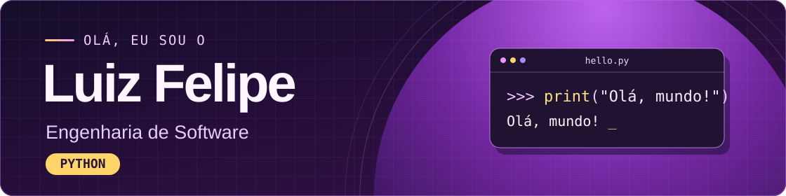

  

  
  

## 👋 Sobre mim

Sou o Luiz Felipe, estudante de **Engenharia de Software no CEUB**. Uso o GitHub para reunir meus projetos acadêmicos e web e registrar o que aprendo na prática.

## 🐍 Meu foco é Python

Estou aprofundando meus estudos em **Python**, com foco em lógica de programação, resolução de problemas e scripts para automatizar tarefas.

~~~python
def apresentar():
    return "Olá, mundo! Eu sou o Luiz Felipe."

print(apresentar())
~~~

Também uso **Git** para versionar meus projetos e trabalho com **HTML, JavaScript e TypeScript** nos projetos web.

## 🚀 Projetos em destaque

| Projeto | O que você encontra |
| :--- | :--- |
| [**portfolioHUB**](https://github.com/luizfelip-dev/portfolioHUB) | Meu portfólio com projetos acadêmicos, incluindo um banco de dados para uma academia e um circuito DC. |
| [**Studio em Dia**](https://github.com/luizfelip-dev/studio-em-dia) | Projeto web em TypeScript. |
